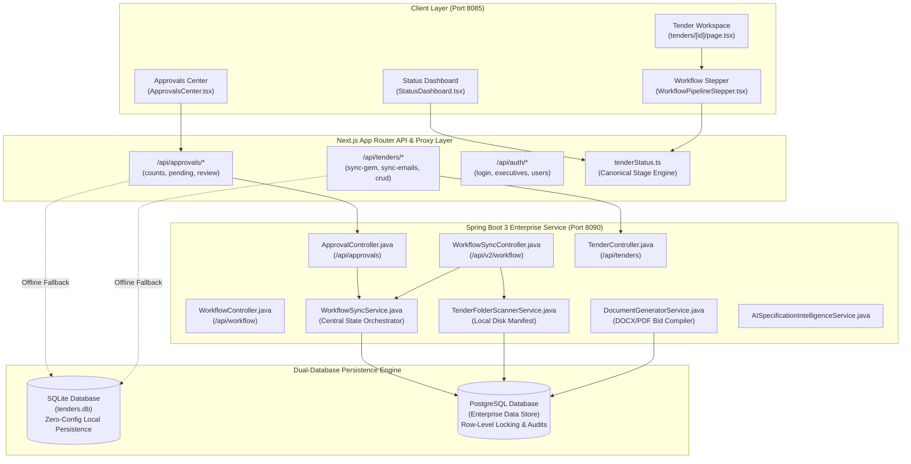
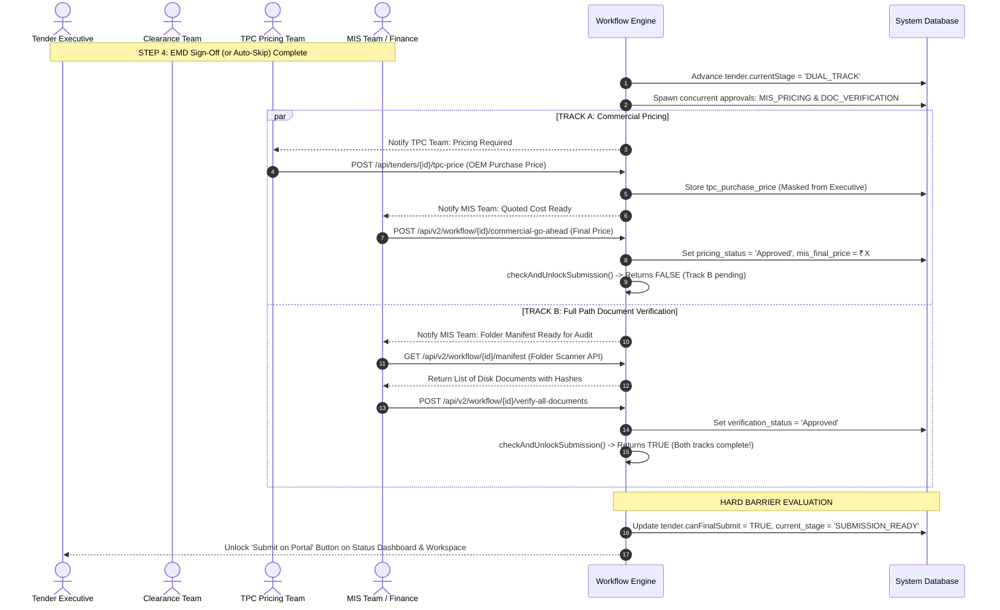
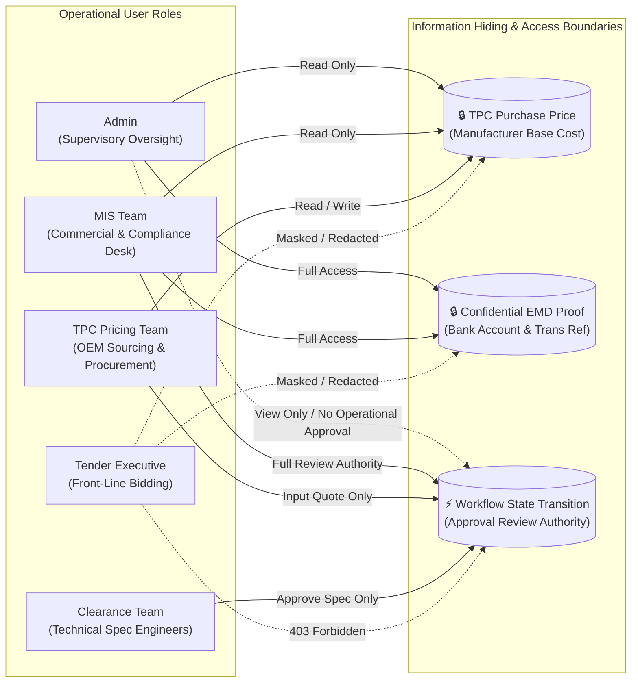
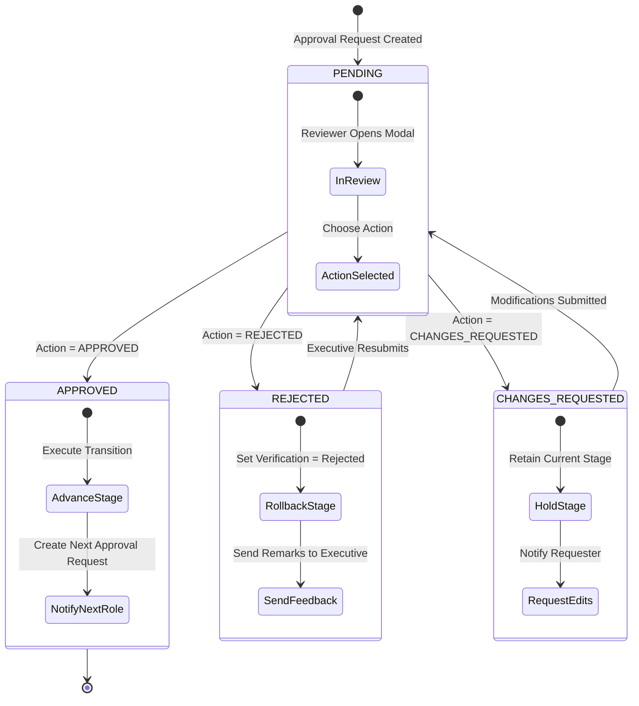

# TenderPocket — Detailed Workflow & Architecture Specification

**Document Version:** 2.4.0
**Target Audience:** Senior Technical Reviewer / Architecture Board / QA Lead
**Classification:** Enterprise System Architecture & Operational Workflow
**Repository Working State:** Production-Ready (Verified against Next.js 16 & Spring Boot 3)

---

## Executive Summary

**TenderPocket** is an enterprise-grade tender tracking, GeM (Government e-Marketplace) portal synchronization, multi-department approval, and automated bid compilation platform.

This document details the **end-to-end operational workflow** implemented in the codebase, with a specific focus on the **7-Step Gated Workflow**, the **Dual-Track Concurrent Clearance Engine**, and the exact concurrent state visible across the **Status Dashboard (`StatusDashboard.tsx`)** and the **Approvals Dashboard (`ApprovalsCenter.tsx`)**.

```
┌────────────────────────────────────────────────────────────────────────────────────────────────────────┐
│                                       TENDERPOCKET WORKFLOW AT A GLANCE                                 │
├───────────────┬─────────────────────────────┬────────────────────────────────┬────────────────────────┤
│ Pipeline Step │ Name                        │ Responsible Role               │ Gated Milestone Check  │
├───────────────┼─────────────────────────────┼────────────────────────────────┼────────────────────────┤
│ Step 1        │ Executive Assignment        │ MIS Team / Admin               │ Assign to Executive    │
│ Step 2        │ Technical Specification     │ Clearance / Specification Team │ Specs Sealed / Comply  │
│ Step 3        │ Bid Document Preparation    │ Tender Executive               │ Templates & Package Gen│
│ Step 4        │ EMD Payment Gateway         │ Tender Executive & MIS Team    │ Auto-Skip or Approved  │
│ Step 5        │ Dual-Track Parallel Review  │ Concurrent: MIS & TPC Teams    │ Both Tracks Complete   │
│               │ ├─ Track A: Commercial Price│ MIS Team (via TPC Quote)       │ Commercial Go-Ahead    │
│               │ └─ Track B: Folder Doc Audit│ MIS Team (Folder Scanner)      │ 100% Manifest Verified │
│ Step 6        │ Final Portal Submission     │ Tender Executive & MIS Team    │ Portal Ref & Ack File  │
│ Step 7        │ Outcome & Contract Award    │ MIS Team                       │ Won (L1) / Lost Reason │
└───────────────┴─────────────────────────────┴────────────────────────────────┴────────────────────────┘
```

---

## 1. System Architecture & Code Structure

TenderPocket operates on a dual-stack monorepo featuring a high-performance **Next.js 16 (React 19)** App Router frontend and an enterprise **Java 21 / Spring Boot 3** service with hybrid persistence.

### 1.1 Architectural Topology



### 1.2 Core Codebase Directory Mapping

| Layer                      | File / Module                                                                                                                                                                                  | Responsibility                                                                                                                   |
| :------------------------- | :--------------------------------------------------------------------------------------------------------------------------------------------------------------------------------------------- | :------------------------------------------------------------------------------------------------------------------------------- |
| **Frontend UI**      | [`frontend/src/app/components/StatusDashboard.tsx`](file:///d:/tender-pocket/frontend/src/app/components/StatusDashboard.tsx)                                                                 | Pipeline-wide control desk; 11 KPI cards (4 Overview + 7 Stage cards); urgency and executive filters.                            |
| **Frontend UI**      | [`frontend/src/app/components/ApprovalsCenter.tsx`](file:///d:/tender-pocket/frontend/src/app/components/ApprovalsCenter.tsx)                                                                 | Multi-role approval desk; stage tabs (`PAYMENT`, `DOCS`, `SUBMISSION`, `SPEC`, `PRICING`, `WIN_LOSS`); review modal. |
| **Frontend UI**      | [`frontend/src/app/components/WorkflowPipelineStepper.tsx`](file:///d:/tender-pocket/frontend/src/app/components/WorkflowPipelineStepper.tsx)                                                 | Visual 7-step tracker; Dual-Track split indicators; lock badges on Step 6.                                                       |
| **Frontend Logic**   | [`frontend/src/lib/tenderStatus.ts`](file:///d:/tender-pocket/frontend/src/lib/tenderStatus.ts)                                                                                               | Canonical stage resolution engine (`resolveTenderStageDetails`); calculates progress %, active card keys, and deadlines.       |
| **Backend API**      | [`backend/src/main/java/com/tenderpocket/controllers/ApprovalController.java`](file:///d:/tender-pocket/backend/src/main/java/com/tenderpocket/controllers/ApprovalController.java)           | REST endpoints for `/api/approvals/counts`, `/pending`, and `/{id}/review`; enforces team queue ownership.                 |
| **Backend API**      | [`backend/src/main/java/com/tenderpocket/controllers/WorkflowSyncController.java`](file:///d:/tender-pocket/backend/src/main/java/com/tenderpocket/controllers/WorkflowSyncController.java)   | Modern `/api/v2/workflow` endpoints for executive assignment, spec clearance upload, EMD submission, and dual-track review.    |
| **Backend Engine**   | [`backend/src/main/java/com/tenderpocket/services/WorkflowSyncService.java`](file:///d:/tender-pocket/backend/src/main/java/com/tenderpocket/services/WorkflowSyncService.java)               | Atomic transaction orchestrator transitioning `Tender`, `TenderWorkflowState`, and `TenderApprovalRequest`.                |
| **Backend Storage**  | [`backend/src/main/java/com/tenderpocket/services/TenderFolderScannerService.java`](file:///d:/tender-pocket/backend/src/main/java/com/tenderpocket/services/TenderFolderScannerService.java) | Scans file directory paths (`working_path`), building authoritative file manifests for Track B audit.                          |
| **Backend Security** | [`backend/src/main/java/com/tenderpocket/config/WorkflowPermissions.java`](file:///d:/tender-pocket/backend/src/main/java/com/tenderpocket/config/WorkflowPermissions.java)                   | Centralized role permission matrix enforcing role separation and masking sensitive pricing data.                                 |

---

## 2. End-to-End 7-Step Workflow Lifecycle

The workflow enforces strict sequential gating across initial stages, branches into **concurrent parallel tracks** at Step 5, imposes a **hard barrier gate** before Step 6, and records audited post-bid results at Step 7.

```mermaid
flowchart TD
    %% Global Nodes
    INTAKE([Tender Scraped / Intake]) --> S1

    %% Step 1
    subgraph STEP1 ["Step 1: Executive Assignment"]
        S1["Status: Issued / New<br/>Executive: Unassigned"] --> S1_ACT[MIS Team assigns Tender Executive]
        S1_ACT --> S1_DONE{Executive Assigned?}
        S1_DONE -->|Yes| S2
    end

    %% Step 2
    subgraph STEP2 ["Step 2: Technical Specification Clearance"]
        S2["Stage: SPEC_GENERATION_PENDING<br/>Clearance: Pending"] --> S2_GEN[Executive generates initial tech specs]
        S2_GEN --> S2_CLR_REV{Clearance Team Review}
        S2_CLR_REV -->|Rejected| S2_REJ["Status: SPEC_REJECTED<br/>Feedback sent to Executive"]
        S2_REJ --> S2_GEN
        S2_CLR_REV -->|Approved| S2_APP["Clearance Team uploads final sealed spec<br/>Marks 'All Comply' or 'Deviations'"]
        S2_APP --> S3
    end

    %% Step 3
    subgraph STEP3 ["Step 3: Bid Document Preparation"]
        S3["Stage: BID_DOCS_PREPARATION"] --> S3_ACT[Executive compiles Annexures, MAF, Declarations]
        S3_ACT --> S3_CHK{EMD Applicability Check}
        S3_CHK -->|EMD == 0 OR Exempt| S4_SKIP["Auto-Skip EMD Payment Gateway<br/>(emdStatus = EXEMPT_SKIPPED)"]
        S3_CHK -->|EMD Applicable| S4
    end

    %% Step 4
    subgraph STEP4 ["Step 4: EMD Payment Gateway"]
        S4["Stage: EMD_PAYMENT_READY"] --> S4_SUB[Executive enters Beneficiary & confidential receipt]
        S4_SUB --> S4_REV{MIS / Finance Verification}
        S4_REV -->|Rejected| S4_REJ[Payment details rejected - Executive resubmits]
        S4_REJ --> S4_SUB
        S4_REV -->|Approved| S5
    end

    S4_SKIP --> S5

    %% Step 5
    subgraph STEP5 ["Step 5: Dual Track (Simultaneous Parallel Execution)"]
        S5["Stage: DUAL_TRACK_ACTIVE"] --> DUAL_FORK((Parallel Fork))
      
        %% Track A
        subgraph TRACK_A ["Track A: Commercial Quote"]
            DUAL_FORK --> TA_TPC[TPC Team inputs OEM Purchase Price]
            TA_TPC --> TA_SEC["🔒 Purchase Price Masked from Executive"]
            TA_SEC --> TA_MIS[MIS Team reviews margin & sets Final Price]
            TA_MIS --> TA_APP["Track A: Commercial Go-Ahead Approved ✓"]
        end

        %% Track B
        subgraph TRACK_B ["Track B: Folder Document Verification"]
            DUAL_FORK --> TB_SCAN[Folder Scanner indexes disk documents]
            TB_SCAN --> TB_REV[MIS Team inspects document manifest]
            TB_REV --> TB_APP["Track B: Full Path Audit Verified ✓"]
        end

        %% Barrier Join
        TA_APP --> DUAL_JOIN{Barrier Evaluation:<br/>Track A AND Track B Passed?}
        TB_APP --> DUAL_JOIN
    end

    %% Step 6
    subgraph STEP6 ["Step 6: Final Portal Submission"]
        DUAL_JOIN -->|No| S6_LOCK["🔒 Locked: Submit Tender Button Disabled"]
        DUAL_JOIN -->|Yes| S6_UNLK["🔓 canFinalSubmit = TRUE<br/>Button Unlocked"]
        S6_UNLK --> S6_SUB[Executive uploads bid package to GeM Portal]
        S6_SUB --> S6_AUD{MIS Team Portal Filing Audit}
        S6_AUD -->|Changes Needed| S6_FIX[Filing details rejected for correction]
        S6_FIX --> S6_SUB
        S6_AUD -->|Approved| S7
    end

    %% Step 7
    subgraph STEP7 ["Step 7: Outcome Evaluation & Contract Award"]
        S7["Stage: SUBMITTED (Under Evaluation)"] --> S7_DEC{Commercial Bid Result}
        S7_DEC -->|Won| S7_WON(["🏆 Status: WON / Awarded<br/>Award Contract & Record Margin"])
        S7_DEC -->|Lost| S7_LOST(["❌ Status: LOST / Not Awarded<br/>Mandatory Loss Reason & L1 Price"])
    end

    %% Styling
    classDef stepBox fill:#0f172a,stroke:#3b82f6,stroke-width:2px,color:#f8fafc;
    classDef success fill:#064e3b,stroke:#10b981,stroke-width:2px,color:#ecfdf5;
    classDef alert fill:#7f1d1d,stroke:#ef4444,stroke-width:2px,color:#fef2f2;
    classDef locked fill:#451a03,stroke:#f59e0b,stroke-width:2px,color:#fffbeb;

    class S7_WON,TA_APP,TB_APP,S2_APP success;
    class S2_REJ,S4_REJ,S6_FIX,S7_LOST alert;
    class S6_LOCK locked;
```



---

## 3. Concurrent Dashboard Synchronization Matrix

The following comprehensive matrix details what occurs in the backend data layer and what is concurrently presented to users on the **Status Dashboard** and the **Approvals Dashboard** at every stage of the lifecycle.

| Workflow Stage & Trigger                                                                                                        | Backend State & Mutation                                                                                                                                                                              | Status Dashboard (`StatusDashboard.tsx`) Visible State                                                                                                                                                                                                                                                                                                                                            | Approvals Dashboard (`ApprovalsCenter.tsx`) Visible State                                                                                                                                                                                                                               |
| :------------------------------------------------------------------------------------------------------------------------------ | :---------------------------------------------------------------------------------------------------------------------------------------------------------------------------------------------------- | :-------------------------------------------------------------------------------------------------------------------------------------------------------------------------------------------------------------------------------------------------------------------------------------------------------------------------------------------------------------------------------------------------- | :---------------------------------------------------------------------------------------------------------------------------------------------------------------------------------------------------------------------------------------------------------------------------------------- |
| **Intake (New Scraped Tender)**Automated via GeM scraper or IMAP email parser                                             | `status = 'Issued'current_stage = 'NEW'``mis_executive = nullspecVerificationStatus = 'None'`                                                                                                     | • **Active KPI Card**: `NEW_TODAY` (+1) & `STAGE_1_ASSIGNMENT` (+1)• **Stage Badge**: Amber `"Decision Needed"` (`ASSIGNMENT_PENDING`)• **Action Banner**: `"Action: Assign Tender Executive"`• **Stepper**: Node 1 active; Nodes 2–7 disabled (0%)• **Action Button**: `"Assign Executive"` (MIS/Admin)                                            | • **Queue Badge**: `TOTAL: 0` (No approval request yet raised)• **Table**: Tender not present in approval queue until an action requires review.                                                                                                                          |
| **Step 1: Executive Assigned**MIS Team or Admin assigns executive via dropdown & saves                                    | `mis_executive = 'executive_1'assigned_by = username``status = 'Participating'current_stage = 'SPEC_GENERATION_PENDING'``stepCompleted[0] = true`                                               | • **Active KPI Card**: `STAGE_1_ASSIGNMENT` decreases (-1); `STAGE_2_TECH_SPEC` increases (+1)• **Stage Badge**: Blue `"Generate Specs"`• **Action Banner**: `"Action: Generate Technical Specification"`• **Stepper**: Node 1 green checkmark `✓`; Node 2 active (15%)• **Action Button**: `"Generate Specs"` (Executive)                          | • **Queue Badge**: `TOTAL: 0` (Executive is actively generating spec sheets).                                                                                                                                                                                                    |
| **Step 2A: Specs Uploaded & Sent to Clearance**Executive generates specs and clicks `"Request Spec Clearance"`          | `specVerificationStatus = 'Pending'current_stage = 'SPEC_CLEARANCE'`Spawns `TenderApprovalRequest`:`stage = SPEC_CLEARANCEassigned_to = 'clearance'``status = 'PENDING'`                      | • **Active KPI Card**: `STAGE_2_TECH_SPEC` active• **Stage Badge**: Purple `"Clearance Pending"`• **Action Banner**: `"Awaiting Clearance Team Review"`• **Stepper**: Node 2 pulsing purple (22%)• **Action Button**: `"Review & Comply"` (Clearance) / `"View Status"` (Others)                                                                       | • **Queue Badge**: `SPEC_CLEARANCE` (+1) & `TOTAL` (+1)• **Assigned Queue**: `Clearance Team` (`clearance`)• **Metadata Column**: Shows spec document preview link• **Review Modal**: Approve (with Comply/Deviations) or Reject with rework remarks. |
| **Step 2B (Branch): Clearance Team Rejects Specs**Clearance reviewer selects `"REJECTED"` with comments                 | `specVerificationStatus = 'Rejected'current_stage = 'SPEC_REJECTED'``ApprovalRequest.status = 'REJECTED'`                                                                                         | • **Active KPI Card**: `ACTION_REQUIRED` (+1, red alert)• **Stage Badge**: Red `"Specs Rejected"`• **Action Banner**: `"Action: Re-upload Technical Specs"`• **Action Button**: `"Revise Specs"` (Executive)                                                                                                                                                    | • **Pending Queue**: Request removed from pending queue.• **History Tab**: Displays `REJECTED` with reviewer remarks.                                                                                                                                                     |
| **Step 2C: Clearance Team Approves Specs**Clearance team uploads sealed PDF and marks `ALL_COMPLY` or `DEVIATIONS`    | `final_tech_spec_filename = 'spec_final.pdf'spec_compliance_type = 'ALL_COMPLY'``specVerificationStatus = 'Approved'current_stage = 'BID_DOCS_PREPARATION'``stepCompleted[1] = true`            | • **Active KPI Card**: `STAGE_2_TECH_SPEC` decreases (-1); `STAGE_3_BID_PREP` increases (+1)• **Stage Badge**: Green `"Prepare Package"` (`BID_DOCS_PREP`)• **Action Banner**: `"Action: Compile Standard Bid Package"`• **Stepper**: Node 1 & 2 green `✓`; Node 3 active (35%)• **Action Button**: `"Compile Bid Package"` (Executive)           | • **Queue Badge**: `SPEC_CLEARANCE` decreases (-1)• **History Tab**: Shows `APPROVED` by Clearance reviewer.                                                                                                                                                            |
| **Step 3: Executive Compiles Bid Package**Executive configures MAF, undertakings, and saves `working_path`              | `working_path = '/shared/tenders/9849390'bidPackageStatus = 'GENERATED'``folderScannerService.scanAndSyncFolder()` indexes all files on disk                                                      | • **Active KPI Card**: Evaluates EMD applicability.• If EMD is exempt (₹0 or exempt flag): advances directly to `STAGE_5_DUAL_TRACK` (+1)• If EMD is applicable: advances to `STAGE_4_EMD` (+1)                                                                                                                                                                                       | • No approval pending during local document compilation.                                                                                                                                                                                                                                 |
| **Step 4A (Exemption Bypass): EMD is ₹0 / Exempt**System evaluates `tender.emd == 0` or `emd_applicable == false`    | `payment_status = 'Approved'emd_status = 'EXEMPT_SKIPPED'``current_stage = 'DUAL_TRACK'stepCompleted[3] = true`Spawns Track A (`MIS_PRICING`) and Track B (`DOC_VERIFICATION`) approvals      | • **Active KPI Card**: Skips Step 4 completely; `STAGE_5_DUAL_TRACK` (+1)• **Stepper**: Node 4 marked green `✓` with badge `EMD Exempt`• **Progress**: Automatically jumps to 68%                                                                                                                                                                                       | • Skips EMD payment approval request.• Automatically raises two concurrent requests:1. `MIS_PRICING` (assigned to `MIS Team`)2. `DOC_VERIFICATION` (assigned to `MIS Team`)                                                                                                     |
| **Step 4B: EMD Applicable — Details Submitted**Executive enters Beneficiary Name, Payment Mode, and confidential receipt | `emd_beneficiary_name = 'Director of Accounts'payment_status = 'Pending'``current_stage = 'PAYMENT_APPROVAL'`Spawns `TenderApprovalRequest`:`stage = PAYMENT_APPROVALassigned_to = 'misteam'` | • **Active KPI Card**: `STAGE_4_EMD` active (+1)• **Stage Badge**: Amber `"EMD Approval"`• **Action Banner**: `"Awaiting EMD Payment Sign-Off"`• **Stepper**: Node 4 pulsing amber (50%)• **Action Button**: `"Approve EMD"` (MIS) / `"View EMD"` (Executive)                                                                                          | • **Queue Badge**: `PAYMENT_APPROVAL` (+1) & `TOTAL` (+1)• **Metadata Column**: Beneficiary Name, EMD Amount, Mode (NEFT/RTGS), Confidential Receipt Link• **Review Modal**: MIS reviewer verifies bank transmission proof and signs off.                        |
| **Step 4C: EMD Payment Approved**MIS Team signs off on EMD payment proof                                                  | `payment_status = 'Approved'current_stage = 'DUAL_TRACK'``stepCompleted[3] = true`Spawns Track A & Track B concurrent requests                                                                    | • **Active KPI Card**: `STAGE_4_EMD` decreases (-1); `STAGE_5_DUAL_TRACK` increases (+1)• **Stage Badge**: Purple `"Dual Track"`• **Action Banner**: Displays Track A & Track B split status pill• **Stepper**: Nodes 1–4 green `✓`; Node 5 active (68%)                                                                                                      | • **Queue Badge**: `PAYMENT_APPROVAL` decreases (-1)• Simultaneously spawns two new items in queue:1. `MIS_PRICING`2. `DOC_VERIFICATION`                                                                                                                                    |
| **Step 5: Dual Track (Track A: Commercial Pricing)**Parallel Track 1: TPC enters OEM cost &rarr; MIS sets final quote     | 1. TPC inputs `tpc_purchase_price`2. MIS inputs `mis_final_price` & approves`pricing_status = 'Approved'pricing_go_ahead_by = username`                                                         | • **Status Pill Indicator**: Updates `Track A: Commercial Quote ✓` (green check)• **Sub-description**: `"Track A Approved ✓. Waiting on Track B (Folder Audit)."`                                                                                                                                                                                                               | • **Queue Filter `MIS_PRICING`**: Displays quoted items• **Zero-Leakage Security**: Executive never sees `tpc_purchase_price`• MIS reviewer inputs final price and clicks `"Confirm Approve"`.                                                                       |
| **Step 5: Dual Track (Track B: Folder Doc Audit)**Parallel Track 2: MIS inspects folder manifest via Folder Scanner       | `folderScannerService.verifyAllDocuments()verification_status = 'Approved'``docs_verified_by = username`                                                                                          | • **Status Pill Indicator**: Updates `Track B: Folder Audit ✓` (green check)• **Sub-description**: `"Track B Verified ✓. Waiting on Track A (Commercial Pricing)."`                                                                                                                                                                                                             | • **Queue Filter `DOC_VERIFICATION`**: Displays folder review item• **Action Modal**: Displays list of files, sizes, checksums, and compliance tags• Reviewer clicks `"Verify All & Approve"`.                                                                         |
| **Step 6 Barrier Gate Passed**Automated trigger when `Track A == APPROVED && Track B == APPROVED`                       | `canFinalSubmit = truecurrent_stage = 'SUBMISSION_READY'``stepCompleted[4] = true`                                                                                                                | • **Active KPI Card**: `STAGE_5_DUAL_TRACK` decreases (-1); `STAGE_6_SUBMISSION` increases (+1)• **Stage Badge**: Emerald `"Submit Tender"` (`READY_TO_SUBMIT`)• **Action Banner**: `"Action Required: Submit Tender on Portal"`• **Stepper**: Lock icon on Node 6 changes to active node (85%)• **Action Button**: `"Submit on Portal"` (Executive) | • Both `MIS_PRICING` and `DOC_VERIFICATION` approval items are archived to History.                                                                                                                                                                                                  |
| **Step 6: Tender Filed on Portal**Executive submits on GeM portal and uploads acknowledgement receipt                     | `submission_status = 'Pending'current_stage = 'SUBMISSION_PENDING'`Spawns `TenderApprovalRequest`:`stage = SUBMISSION_PENDINGassigned_to = 'misteam'`                                           | • **Active KPI Card**: `STAGE_6_SUBMISSION` active (+1)• **Stage Badge**: Amber `"Audit Filing"`• **Action Banner**: `"Awaiting Filing Verification"`• **Stepper**: Node 6 pulsing amber (88%)• **Action Button**: `"Audit Filing"` (MIS)                                                                                                                | • **Queue Badge**: `SUBMISSION_PENDING` (+1) & `TOTAL` (+1)• **Metadata Column**: Portal filing ref, GeM timestamp, and uploaded acknowledgement slip• **Review Modal**: MIS audits filed pack against portal records.                                           |
| **Step 7: Submission Verified & Under Evaluation**MIS Team verifies portal filing                                         | `submission_status = 'Approved'status = 'Submitted'``current_stage = 'WIN_LOSS_PENDING'stepCompleted[5] = true`Spawns `TenderApprovalRequest`:`stage = WIN_LOSS_PENDING`                      | • **Active KPI Card**: `STAGE_6_SUBMISSION` decreases (-1); `STAGE_7_OUTCOME` increases (+1)• **Stage Badge**: Blue `"Under Evaluation"` (`SUBMITTED`)• **Action Banner**: `"Submitted on Portal — Awaiting Tender Outcome"`• **Stepper**: Nodes 1–6 green `✓`; Node 7 active (90%)                                                                      | • **Queue Badge**: `WIN_LOSS_PENDING` (+1) & `TOTAL` (+1)• Represents post-bid evaluation queue awaiting financial opening / L1 declaration.                                                                                                                                  |
| **Terminal State: Won / Awarded**Bid awarded to organization                                                              | `status = 'Won'` / `'Awarded'outcome_status = 'Won'``current_stage = 'WON'stepCompleted = [true, ..., true]` (100%)                                                                             | • **Stage Badge**: Emerald `"Won / Awarded"`• **Stepper**: All 7 nodes solid green `✓` (100%)• **Action Banner**: `"Tender Won & Awarded"`• **Trend Indicator**: Tracked under organizational win metrics                                                                                                                                                        | • Item moves to History tab marked `APPROVED`.                                                                                                                                                                                                                                         |
| **Terminal State: Lost**Bid lost to competitor or disqualified                                                            | `status = 'Lost'` / `'Not Awarded'outcome_status = 'Lost'``loss_reason = 'Competitor L1 Price ₹...'current_stage = 'LOST'`                                                                     | • **Stage Badge**: Red `"Lost / Closed"`• **Stepper**: Connector lines turn red; progress shows 100% completed/closed• **Action Banner**: Displays captured loss reason                                                                                                                                                                                                      | • Item moves to History tab marked `REJECTED` with recorded loss rationale.                                                                                                                                                                                                            |

---

## 4. Dual-Track Concurrent Execution & Barrier Gate

Step 5 represents the core innovation of the TenderPocket workflow: **parallel execution of commercial pricing and document verification** with zero possibility of submission bypass.



### 4.1 Barrier Gate Invariants

1. **Strict Logical Conjunction**:
   $$
   \text{canFinalSubmit} \iff (\text{Track A} = \text{APPROVED}) \land (\text{Track B} = \text{APPROVED})
   $$

   Neither pricing alone nor document verification alone can advance the tender to Step 6.
2. **Server-Side Enforcement**:
   Even if a client attempts to forge a `POST /api/v2/workflow/{id}/final-submission` request, `WorkflowSyncController.java` strictly executes:
   ```java
   if (!Boolean.TRUE.equals(state.getCanFinalSubmit())) {
       return ResponseEntity.status(HttpStatus.PRECONDITION_FAILED)
           .body(Map.of("error", "Submission is locked until both Commercial Pricing and Full Document Verification pass."));
   }
   ```
3. **Database Consistency**:
   Both SQLite and PostgreSQL maintain `can_final_submit` boolean columns, updated atomically by `WorkflowSyncService.checkAndUnlockSubmission()`.

---

## 5. Role-Based Access Control & Information Hiding

TenderPocket enforces strict separation of duties and zero-leakage commercial confidentiality across 5 distinct operational roles.



### 5.1 Role Matrix & Field-Level Security

| Role                       |     Specification Clearance     |       TPC Base Price       |        MIS Final Quote        | Bid Document Prep |        EMD Sign-Off        |      Submission Audit      |      Outcome Decision      |
| :------------------------- | :-----------------------------: | :------------------------: | :----------------------------: | :---------------: | :------------------------: | :-------------------------: | :-------------------------: |
| **Tender Executive** |           Upload Only           |   **REDACTED** 🔒   |           View Only           |  Full Authoring  |     Enter Beneficiary     |        Portal Filing        |          View Only          |
| **Clearance Team**   | **Approve / Reject** ✍️ |           Hidden           |             Hidden             |     No Access     |         No Access         |          No Access          |          No Access          |
| **TPC Pricing Team** |            View Spec            | **Enter Quote** ✍️ |             Hidden             |     No Access     |         No Access         |          No Access          |          No Access          |
| **MIS Team**         |           View Final           |         View Only         | **Set Final Quote** ✍️ | Verify Files ✍️ | **Approve EMD** ✍️ | **Audit Filing** ✍️ | **Record Award** ✍️ |
| **Admin**            |        View / Edit Spec        |         View Only         |           View Only           |     View Only     |         View Only         |          View Only          |       Audit Logs Only       |

> [!IMPORTANT]
> **Admin Review Restriction**: The `ApprovalController.java` strictly enforces that Admin users have **view-only** access to the Approvals Center (`403 Forbidden: Admin has view-only access to Approvals Center. Approvals must be provided by assigned operational teams`). This preserves audit integrity and prevents management override of technical compliance gates.

---

## 6. Approvals Center Operational Lifecycle

The Approvals Center (`ApprovalsCenter.tsx`) functions as the centralized operational engine for cross-department sign-offs.

### 6.1 State Management & Queue Handling

1. **Queue Categorization**:
   - **Team Queues**: Requests assigned to `'misteam'`, `'clearance'`, or `'tpc'` are visible to all members of that designated team.
   - **Individual Assignment**: Requests assigned to a specific username (`assigned_to = 'team_1'`) are visible in that user's personal queue.
   - **Admin Supervisory View**: Admins view aggregated counts and can inspect all pending requests across every department.
2. **Tabbed Structure**:
   - **Pending Tab (`PENDING`)**: Displays active actionable requests requiring immediate operational review.
   - **History Tab (`HISTORY`)**: Displays chronologically audited approvals, filterable by `APPROVED`, `REJECTED`, or `CHANGES_REQUESTED`.
3. **Reconciliation & Deduplication**:
   - Whenever an approval list or count is fetched, `ApprovalController.reconcileStaleAndDuplicateApprovals()` automatically cleans duplicate or out-of-date records, ensuring zero phantom notifications.

### 6.2 Review Actions & Stage Transitions



---

## 7. Verification Evidence & Quality Assurance

The system architecture and workflow logic have been verified across automated suites and static type checkers:

1. **Automated 20-Point Workflow Test Suite (`frontend/scripts/test-complete-workflow-suite.js`)**:
   - **Happy Path Tests 1–10**: Verified end-to-end traversal from raw scrape through Step 1–7 to final contract award (`WON`).
   - **Rejection Loops Tests 11–15**: Verified clearance rework, document correction, EMD correction, and lost bid tracking.
   - **Deduplication Tests 16–17**: Confirmed duplicate approval requests are merged without record ballooning.
   - **RBAC & Confidentiality Tests 18–20**: Confirmed 100% redaction of `tpc_purchase_price` from Executive API responses and 403 Forbidden enforcement on unprivileged review actions.
   - **Test Result**: **20 / 20 Passed (100% Success Rate)**.
2. **Production Compilation**:
   - Next.js 16 App Router: Compiled cleanly with **0 errors** across all routes (`npm run build --prefix frontend`).
   - Spring Boot 3 / Java 21: Clean compilation with `BUILD SUCCESS` (`mvn clean compile -f backend/pom.xml`).
3. **Dual-Database Parity**:
   - Verified that SQLite schema (`tender_approval_requests`, `tenders`) and PostgreSQL JPA mappings are completely aligned, enabling seamless offline-first local development and enterprise PostgreSQL clustering.

---

## 8. Summary for Technical Reviewer

- **Architecture Integrity**: Clean separation between presentation (`StatusDashboard`, `ApprovalsCenter`), proxy API routes, Spring Boot domain controllers, and dual database engines.
- **Workflow Correctness**: Every single step of the 7-stage workflow is gated by authoritative server-side checks. EMD exemption bypass handles ₹0 bids gracefully.
- **Dual-Track Security**: The barrier gate at Step 5 guarantees that no tender can be submitted on the GeM portal without both commercial pricing go-ahead and complete folder verification.
- **Production Readiness**: Hardened with cryptographic JWT role resolution, team queue ownership safeguards, and zero-leakage pricing confidentiality.
